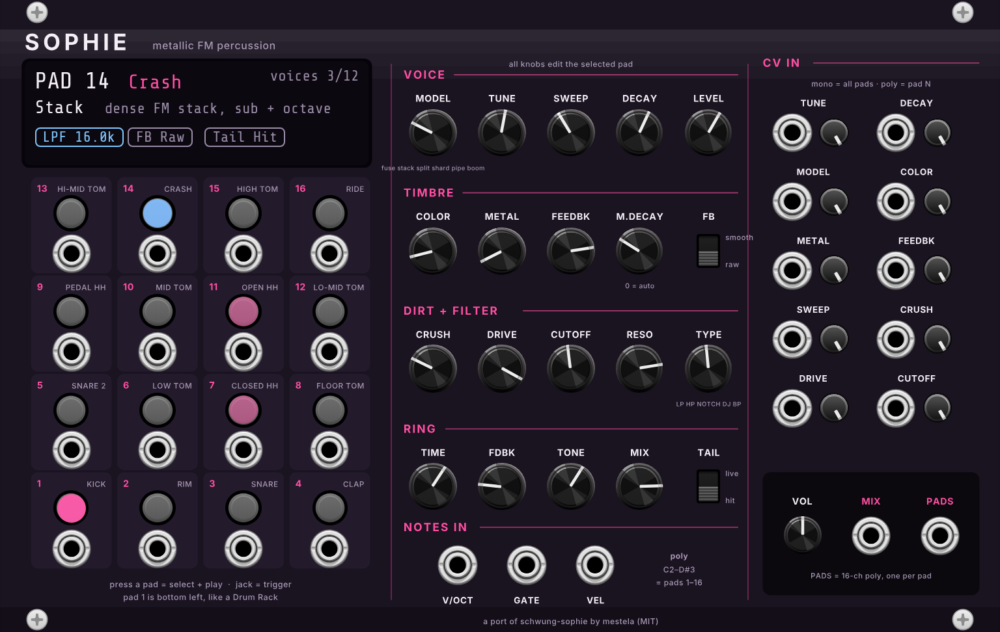

# Sophvcv

**Sophie** for VCV Rack 2: a sixteen-pad metallic FM percussion synthesizer.
It makes kicks, clangs, zaps, bells, shards and unstable digital impacts from
synthesis alone, with no samples.

This is a port of [mestela/schwung-sophie](https://github.com/mestela/schwung-sophie)
(v0.6.0, MIT), which runs on Ableton Move. The sound engine is the same code,
line for line: an offline test plays both versions and checks they produce
the same samples. What's new is the modular side: a trigger jack for every
pad, polyphonic CV, a per-pad poly output and a display.

## How it works in one paragraph

There are 16 pads, each with its own complete sound. **Press a pad** to play
it and to make it the **selected pad**: all the knobs in the middle now show
and edit that pad only (the display says which one). Each pad has a
**trigger jack** under it, so you can patch a Pam's or Marbles output straight
to the kick or the hats. Up to 12 hits can ring at once.

## The knobs (they edit the selected pad)

| Row | Knob | What it does |
|---|---|---|
| Voice | **Model** | The operator structure: **Fuse** (two modulators in series), **Stack** (dense FM with sub and octave), **Split** (two parallel operators), **Shard** (a stepped 12-bit wave plus noise), **Pipe** (FM plus ring modulation), **Boom** (clean sine body with a metallic attack). On pad 1, the first four keep a sine kick body and add texture |
| | **Tune** | Moves the pad up or down by up to 2 octaves (each pad's base pitch comes from its MIDI note, 36–51) |
| | **Sweep** | A fast pitch envelope. Right = falls from above (kick and tom "doom"), left = rises from below (zaps) |
| | **Decay** | How long the hit lasts, from a 30 ms click to a 4 s ring |
| | **Level** | Pad volume |
| Timbre | **Color** | Moves the oscillators through inharmonic ratios. This is the "which metal" control |
| | **Metal** | FM depth: how bright and dense the spectrum is |
| | **Feedbk** | Feeds the voice back into its first operator. High = noisy, gritty, unstable |
| | **M.Decay** | How fast the brightness fades, separately from the volume (ms). 0 = auto. Try 40 vs 400 ms with a long Decay |
| | **FB** switch | **Raw** (the original) or **Smooth**: finer low feedback, tamer highs, detuned oscillators. A different sound, not a "better" one |
| Dirt + filter | **Crush** | Lowers bit depth and sample rate together |
| | **Drive** | Soft clipping. Above halfway it gets properly destructive |
| | **Cutoff**, **Reso** | The pad's filter. It comes last, so it can tame everything Crush, Drive and Ring add |
| | **Type** | LPF, HPF, Notch, DJ (one knob sweeps low-pass → band-pass → high-pass) and BPF |
| Ring | **Time** | A short delay, 0.5–30 ms. Under 10 ms it's a metallic comb resonance |
| | **Fdbk** | How long the ring sustains |
| | **Tone** | Darker or brighter repeats |
| | **Mix** | 0 = off. Turn up to hear the ring |
| | **Tail** switch | **Hit**: each hit keeps the settings it started with. **Live**: hits that are still ringing follow Color, Metal, Feedback, Cutoff and Resonance as you move them (or as CV moves them) |

## Jacks

| Jack | |
|---|---|
| **Pad trigger** (×16) | A trigger or gate above 1 V plays the pad at full velocity. Option: let the trigger's height set velocity (10 V = full) |
| **V/OCT, GATE, VEL** (notes in) | Polyphonic. Notes C2–D#3 play pads 1–16, which are MIDI notes 36–51, the same layout as an Ableton Drum Rack. Patch VCV's **MIDI-CV** (set to polyphonic) here to play Sophie from Live, the Hapax or any drum pads. VEL is 0–10 V; without it every hit is full velocity |
| **CV in** (×10) | Tune (1 V/oct), Decay, Model (1 V per model), Color, Metal, Feedbk, Sweep, Crush, Drive, Cutoff. Each has an amount trimmer (starts fully right = 100%; centre = off; left = inverted). **A mono cable moves all 16 pads. A polyphonic cable sends channel 1 to pad 1, channel 2 to pad 2 and so on.** In Hit mode the CV is read at the moment of each hit, like a parameter lock |
| **VOL** | Output volume |
| **MIX** | Everything, mono |
| **PADS** | 16-channel polyphonic: each pad on its own channel. Use VCV's **Split** to send the kick and the hats to different effects, or the kick to a sidechain |

CV scaling: Color, Metal, Feedbk, Crush, Drive and Cutoff move 10% per volt.
Sweep moves 20% per volt. Decay doubles every 2 V.

## Right-click menu

- **Copy pad / Paste pad / Paste pad to all 16**
- **Reset pad to factory sound**, **Reset whole kit to factory**
- **Mutate pad**: a small random nudge to Color, Metal, Feedback, Sweep, Decay and Cutoff. Press it a few times to drift a sound
- **Trigger height sets velocity**
- **Incoming hits select their pad**: the knobs jump to whatever pad just played

Rack's own **Randomize** (Ctrl+R) randomizes the selected pad only.

## Patches to try

1. **Detroit kit from Pam's.** Pam's outputs to pad 1 (kick), 3 (snare), 7 (closed hat) and 11 (open hat). Set pad 7 and 11 to a short Decay. Send MIX to Live through the disting NT.
2. **Self-mutating metals (the Autechre one).** Marbles X1 → Color CV, X2 → Metal CV, both trimmers about 40%. Marbles' t-outputs to pads 2, 9 and 14. Every hit gets a new metal; Marbles' Deja Vu decides how often it repeats.
3. **Ringing bell lines.** Pad 14 (Crash): Model Pipe, Decay 2 s, Metal 50%, M.Decay 300 ms, Ring Time 3 ms, Fdbk 70%, Mix 40%. Sequence its Tune CV from the Metropolix (1 V/oct) and trigger it with the same gates.
4. **Live filter tails.** Any long pad: Tail = Live, Filter = DJ. Hit it, then sweep Cutoff with an LFO into the Cutoff CV: the ringing tail moves while it plays.
5. **One knob, 16 sounds.** Make a 16-channel poly CV (e.g. VCV **Merge**, or a poly random source) into Color. Each pad gets its own offset from one cable.

## Building

GitHub Actions tests the engine against the original and builds the Apple
Silicon version on every push (see `.github/workflows/build.yml`). The
`.vcvplugin` file appears on this repository's
[latest release](../../releases/tag/latest). To build locally, download the
Rack SDK and run `make dist RACK_DIR=/path/to/Rack-SDK`.

- `src/SophieEngine.hpp`: the sound engine, with no Rack code in it
- `src/Sophie.cpp`: the module (panel, jacks, pad memory, display)
- `res/make_panel.py`: draws `res/Sophie.svg` (needs `pip install fonttools`)
- `test/engine_test.cpp`: renders the original C code (`test/reference/`) and
  the port side by side and checks they match sample for sample

## Credits and license

MIT. Sophie's DSP is by Matt Estela
([schwung-sophie](https://github.com/mestela/schwung-sophie)); Pipe, Boom and
the brightness and feedback ideas come from
[soejrd/digisophie](https://github.com/soejrd/digisophie) (MIT). Sophie is an
original instrument assembled from established synthesis techniques. It is not
a Monomachine emulation, and is not affiliated with or endorsed by Elektron or
the estate of SOPHIE.
